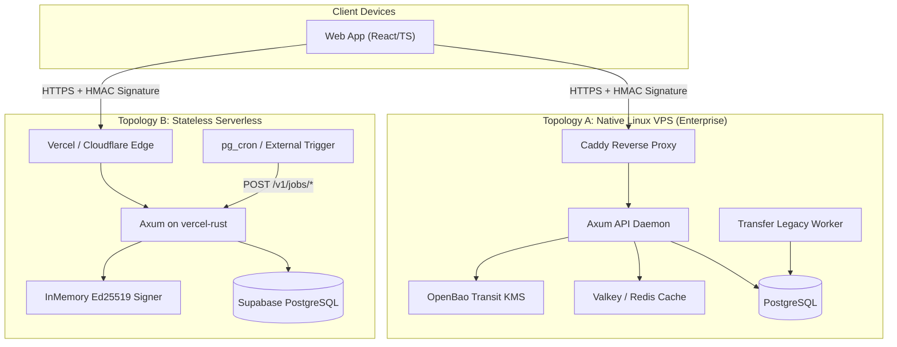

# Transfer Legacy — Backend Services

<div align="center">

[](https://www.rust-lang.org/)
[](https://github.com/tokio-rs/axum)
[](https://www.postgresql.org/)
[](https://supabase.com/)
[](https://csrc.nist.gov/pubs/fips/203/final)
[](.github/workflows/ci.yml)
[](#license)

**Secure, zero-knowledge, production-grade backend engine for digital inheritance and asset continuity.**

[API Reference](docs/api/API_REFERENCE.md) • [Deployment Guide](DEPLOYMENT_GUIDE.md) • [Engineering Rules](rules/) • [Architecture ADRs](docs/adr/) • [Frontend Repository](https://github.com/DeshuGoyel/transfer-legacy-frontend)

</div>

---

## 📌 Architectural Overview

The **Transfer Legacy Backend** provides high-throughput, memory-safe, and zero-knowledge backend infrastructure for managing encrypted vaults, heartbeat liveness verification, M-of-N guardian attestation, and cryptographically verifiable audit logs.

### Core Architectural Axioms
1. **Zero-Knowledge by Design:** The server *never* possesses or derives plaintext vault contents or user master keys. All sensitive payloads arrive as client-side AEAD envelopes (`nonce` + `ciphertext`).
2. **App-Layer Envelope Encryption:** In addition to TLS transport encryption, internal payload communications use authenticated encryption with associated data (AEAD).
3. **Cryptographic Tamper-Evident Ledger:** Every state mutation produces an append-only, SHA-256 hash-chained audit event anchored periodically to immutable external object storage (Backblaze B2).
4. **Strict DB-Layer State Machine:** All lifecycle states (e.g., `Active`, `GracePeriod`, `ClaimInitiated`, `QuorumReached`, `Released`) are enforced at the database layer via triggers, row-level constraints, and Row Level Security (RLS) policies.
5. **Dual-Deployment Topology:** Runs either as a stateful native Linux VPS service (with OpenBao KMS, Valkey, and async worker daemons) or as a stateless, auto-scaling Serverless deployment on Vercel / Cloudflare via `vercel-rust`.

---

## 🏗️ Workspace Layout

The repository is structured as a modular Rust Cargo workspace:

```
Transfer-Legacy-backend/
├── crates/
│   ├── api/                      # Axum 0.7 REST API service (VPS & Serverless compatible)
│   │   ├── src/
│   │   │   ├── handlers/         # Endpoint handlers (auth, vault, heartbeats, claims, ops, jobs)
│   │   │   ├── middleware/       # Signature verification, replay prevention, rate-limiting, AEAD
│   │   │   ├── state.rs          # Server state & dependency injection containers
│   │   │   └── main.rs           # Application bootstrap and route registration
│   ├── crypto-core/              # Canonical cryptographic primitives & utilities
│   │   ├── src/                  # ML-KEM-768, Ed25519, AEAD (XChaCha20-Poly1305/AES-GCM), HKDF
│   │   └── fuzz/                 # libFuzzer and cargo-fuzz regression targets
│   ├── shared-types/             # Core domain models, API request/response DTOs, and error enums
│   └── worker/                   # Background polling and scheduler daemon (VPS mode)
├── docs/                         # Architecture Decision Records (ADRs), runbooks, observability
│   ├── adr/                      # Architectural decisions (KMS selection, post-quantum, audit ledger)
│   ├── api/                      # OpenAPI specifications and full endpoint documentation
│   ├── observability/            # Grafana dashboards and Prometheus alerting rules
│   └── runbooks/                 # Incident response, manual ops review, and disaster recovery
├── infra/                        # Deployment infrastructure definitions
│   ├── caddy/                    # Reverse-proxy configuration with automatic TLS
│   ├── environments/             # Provider-neutral deployment configurations
│   ├── k6/                       # K6 load testing scenarios (auth, vault writes, heartbeats)
│   ├── openbao/                  # OpenBao Transit KMS policies and initialization scripts
│   ├── profiles/                 # Runtime profiles (local, staging, prod)
│   └── docker-compose.yml        # Local development stack (Postgres, Valkey, OpenBao)
├── migrations/                   # 28+ versioned SQL migration scripts
├── postman/                      # Postman test collections and environment configurations
├── rules/                        # Non-negotiable engineering standards and security policies
│   ├── api.rules.md              # REST design, idempotency, and status code rules
│   ├── code.rules.md             # Rust formatting, linting, and error handling rules
│   ├── crypto.rules.md           # Cryptographic primitives, key hygiene, and randomness rules
│   ├── db.rules.md               # SQL migrations, RLS, and indexing rules
│   ├── infra.rules.md            # Docker, TLS, and infrastructure rules
│   └── security.rules.md         # Threat models, access control, and audit trail rules
├── .env.example                  # Comprehensive environment template
├── Cargo.toml                    # Workspace configuration and shared dependencies
└── vercel.json                   # Serverless routing and build configuration
```

---

## ⚡ Deployment Topologies

The backend supports two deployment profiles governed by the `TL_SERVERLESS` environment variable:



### 1. Enterprise VPS Mode (`TL_SERVERLESS=false`)
- **Key Management:** Uses [OpenBao](https://openbao.org/) (open-source HashiCorp Vault fork) Transit engine for cryptographically isolated envelope operations.
- **Caching & Rate-Limiting:** Valkey / Redis instance for distributed token buckets and session caching.
- **Background Jobs:** Native `transfer-legacy-worker` continuous daemon polling database queues.

### 2. Serverless Mode (`TL_SERVERLESS=true`)
- **Execution:** Stateless AWS Lambda / Vercel Serverless containers running compiled native Rust binaries via `vercel-rust`.
- **Key Management:** `InMemorySigner` using a high-entropy Ed25519 private key (`TL_SERVER_PRIVATE_KEY_B64`).
- **Background Jobs:** Invoked via authenticated HTTP webhooks (`POST /v1/jobs/liveness-check`, `POST /v1/jobs/grace-period-check`) triggered by Supabase `pg_cron` or external scheduler services protected with `TL_CRON_SECRET`.

---

## 🛡️ Security Protocol & Request Authentication

Every sensitive or state-mutating HTTP request to the API is protected against tampering and replay attacks through strict cryptographic headers:

| Header | Description | Validation Rule |
| :--- | :--- | :--- |
| `x-nonce` | High-entropy random hex or UUID | Checked against Redis/database; duplicates rejected |
| `x-seq` | Monotonically increasing sequence number | Verified strictly greater than last recorded sequence |
| `x-timestamp` | Unix timestamp in seconds | Rejects requests with drift exceeding $\pm 300\text{ seconds}$ |
| `x-device-id` | Registered client device public identifier | Checked against active authorized devices |
| `x-signature` | Ed25519 signature of `METHOD + PATH + TIMESTAMP + NONCE + BODY` | Verified against client's registered device public key |
| `x-idempotency-key` | Optional token for idempotent retries | Replays return cached response without re-executing |

---

## 🛠️ Local Development & Setup

### Prerequisites

- **Rust Toolchain:** `1.80.0+` (managed automatically via `rust-toolchain.toml`)
- **PostgreSQL:** `15+` (or a live Supabase project)
- **Docker & Docker Compose:** For running local infrastructure services

### Step-by-Step Setup

1. **Clone the repository:**
   ```bash
   git clone git@github.com:ItsMeVikashKumarSingh/transfer-legacy-backend.git
   cd transfer-legacy-backend
   ```

2. **Configure environment variables:**
   ```bash
   cp .env.example .env.local
   ```
   Open `.env.local` and configure your database credentials, JWT secrets, and signing keys.

3. **Spin up local infrastructure (Postgres, Valkey, OpenBao):**
   ```bash
   docker compose -f infra/docker-compose.yml up -d
   ```

4. **Apply database migrations:**
   ```bash
   # Using standard psql or your preferred migration tool
   for file in migrations/*.sql; do
     psql "$DATABASE_URL" -f "$file"
   done
   ```

5. **Run the API server:**
   ```bash
   # Start the HTTP API service
   cargo run -p transfer-legacy-api
   ```
   The API will listen on `http://127.0.0.1:8080`.

---

## 🧪 Testing & Verification

The codebase maintains strict automated test coverage across cryptographic correctness, state machine invariants, and security compliance:

```bash
# Run all workspace unit and integration tests
cargo test --workspace

# Run security-specific crypto-core tests
cargo test --package transfer-legacy-crypto-core -- --nocapture

# Execute security policy compliance test harness
cargo test --package transfer-legacy-api "tests::security::" -- --nocapture

# Run clippy linter with strict warning enforcement
cargo clippy --workspace --all-targets -- -D warnings

# Verify formatting
cargo fmt --all -- --check

# Check dependency security advisories and license compliance
cargo deny check
cargo audit
```

---

## 📚 API Reference & Postman

- **Interactive Documentation:** Once the server is running, navigate to:
  - Swagger UI: `http://localhost:8080/v1/docs` (when `TL_INTERNAL_API_TOKEN` is supplied or in development mode)
  - Raw OpenAPI v3 Schema: `http://localhost:8080/v1/openapi.json`
- **Postman Workspace:** Ready-to-import collections and environments are available in `postman/`:
  - `postman/Transfer-Legacy.postman_collection.json`
  - `postman/Transfer-Legacy.postman_environment.json`

---

## 📈 Observability & Operations

- **Metrics:** Prometheus metrics exposed at `GET /metrics` (protected by `TL_INTERNAL_API_TOKEN`).
- **Dashboards:** Production Grafana dashboard definition located at `docs/observability/grafana-dashboard.json`.
- **Alert Rules:** Alertmanager rules located at `docs/observability/alerts.yaml`.
- **Load Testing:** Standardized K6 scenarios located at `infra/k6/` (`auth.js`, `vault-write.js`, `heartbeat.js`).
- **Operational Runbooks:**
  - [Incident Response Runbook](docs/runbooks/incident-response.md)
  - [Manual Ops & Review Runbook](docs/runbooks/manual-review-ops.md)
  - [Disaster Recovery & Backup Runbook](docs/runbooks/backup-restore.md)

---

## 📜 Compliance & Security Policies

Engineering standards are strictly checked on every commit and pull request. Review the rules located in [`rules/`](rules/):
- `rules/crypto.rules.md`: Strict zero-knowledge hygiene, nonces, key lifecycles.
- `rules/db.rules.md`: Immutable audit triggers, RLS policies, indexing requirements.
- `rules/api.rules.md`: Error handling, idempotency, AEAD envelope handling.
- `rules/security.rules.md`: Least-privilege roles, audit anchors, signature validation.

---

## 📄 License

Copyright © 2026 Transfer Legacy Global. All rights reserved.  
Confidential and proprietary software.
