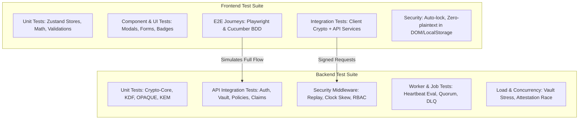
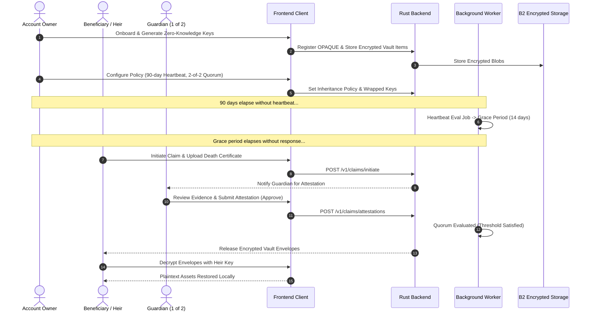

# Transfer Legacy: Master Test Cases Specification (Frontend & Backend)

This document provides the exhaustive test suite matrix for **Transfer Legacy** — covering the Frontend (React, TypeScript, Zustand, Web Crypto/Libsodium) and Backend (Rust Axum, PostgreSQL, Background Workers, OpenBao, B2 Storage, Hybrid Post-Quantum Crypto).

---

## 1. Test Architecture Overview

---

## 2. Backend Test Cases

### 2.1 Authentication, Device & Session Management (`crates/api/src/handlers/auth`)

| Test ID | Category | Test Scenario | Preconditions | Input / Steps | Expected Result |
| :--- | :--- | :--- | :--- | :--- | :--- |
| **TC-BE-AUTH-001** | Functional | OTP Dispatch for Registration | New valid email | `POST /v1/auth/register/send-otp` with `{"email": "user@example.com"}` | HTTP 200 OK, OTP record created with 10-minute expiry; email dispatch queued. |
| **TC-BE-AUTH-002** | Security | OTP Brute-Force Rate Limiting | OTP generated | `POST /v1/auth/register/verify-otp` with incorrect OTP > 5 times | HTTP 429 Too Many Requests or HTTP 400 with remaining attempts decremented; lockout triggered on 5th failure. |
| **TC-BE-AUTH-003** | Functional | OPAQUE Registration Init & Finish | Verified email OTP token | 1. `POST /v1/auth/register/init` with client OPAQUE registration request. 2. `POST /v1/auth/register/finish` with client registration record. | Server persists OPAQUE record and public credential; returns user UUID and session token; server never learns password. |
| **TC-BE-AUTH-004** | Security | OPAQUE Login with Tampered Ciphertext | Registered user | `POST /v1/auth/login/finish` with invalid client credential proof | HTTP 401 Unauthorized; zero secret leakage; audit log records failed auth attempt. |
| **TC-BE-AUTH-005** | Functional | TOTP MFA Enrollment & Verification | Authenticated user | 1. `POST /v1/auth/mfa/totp/enroll` to get secret & QR. 2. `POST /v1/auth/mfa/totp/verify` with valid RFC 6238 6-digit code. | TOTP enabled flag set in DB; backup recovery codes generated and returned encrypted. |
| **TC-BE-AUTH-006** | Functional | WebAuthn / Passkey Registration | WebAuthn supported client | 1. `POST /v1/auth/mfa/webauthn/register/start`. 2. `POST /v1/auth/mfa/webauthn/register/finish` with signed attestation. | WebAuthn credential saved; credential ID indexed to user account. |
| **TC-BE-AUTH-007** | Functional | Step-Up Authentication for Sensitive Actions | Logged-in session | Trigger vault key re-wrap or policy deletion: `POST /v1/auth/stepup/request` and `/stepup/verify` | Elevated short-lived step-up token issued (valid 5 minutes); action permitted only with step-up token. |
| **TC-BE-AUTH-008** | Security | JWT Token Expiration and Refresh Rotation | Valid refresh token | `POST /v1/auth/refresh` with refresh token | New access token and rotated single-use refresh token returned; previous refresh token invalidated. |
| **TC-BE-AUTH-009** | Security | Refresh Token Reuse Detection (Replay Attack) | Old refreshed token | Attempt `POST /v1/auth/refresh` using already-used refresh token | Immediate revocation of ALL sessions for that user family; alert logged to security audit chain. |
| **TC-BE-AUTH-010** | Functional | Device Registration and Revocation | Valid device key pair | 1. `POST /v1/devices/register` with public key and device metadata. 2. `DELETE /v1/devices/:device_id`. | Device registered with state `ACTIVE`; on delete, state changes to `REVOKED` and subsequent requests with device key are rejected with HTTP 403. |

---

### 2.2 Zero-Knowledge Vault & Attachment Management (`crates/api/src/handlers/vault`)

| Test ID | Category | Test Scenario | Preconditions | Input / Steps | Expected Result |
| :--- | :--- | :--- | :--- | :--- | :--- |
| **TC-BE-VAULT-001** | Zero-Knowledge | Create Encrypted Vault Item | Authenticated user | `POST /v1/vault/items` with payload: encrypted blob (XChaCha20-Poly1305), nonce, key version, metadata | HTTP 201 Created; server stores opaque binary blob without verifying or being able to decrypt content. |
| **TC-BE-VAULT-002** | Security | Vault Item Tamper Detection (AEAD Tag Mismatch) | Existing vault item | Modify 1 bit in ciphertext and send `POST /v1/vault/items/update` | Request accepted if server is blind, but client decrypt fails with AEAD authentication error; versioning increments correctly. |
| **TC-BE-VAULT-003** | Isolation | Cross-Tenant Vault Item Access (IDOR Prevention) | User A and User B | User B attempts `POST /v1/vault/items/get` with `item_id` owned by User A | HTTP 404 Not Found or HTTP 403 Forbidden; User B cannot read or detect existence of User A's secret. |
| **TC-BE-VAULT-004** | Functional | Presigned Attachment Upload URL Generation | Vault item created | `POST /v1/vault/items/attachments/presign` with `item_id`, encrypted checksum, file size | Server returns presigned S3/Backblaze B2 PUT URL with strict Content-Length and content-type restrictions. |
| **TC-BE-VAULT-005** | Functional | Confirm Attachment Upload & Encryption Hash | Upload completed to B2 | `POST /v1/vault/items/attachments/confirm` with storage key and client-calculated SHA-256 | Attachment marked `CONFIRMED`; storage path locked to user's encrypted vault scope. |
| **TC-BE-VAULT-006** | Functional | Multi-Recipient Shamir Secret Share Distribution | Vault item with m-of-n policy | `POST /v1/vault/shares` with wrapped key envelopes encrypted for each designated recipient's public key | Server stores individual recipient envelopes; no recipient receives another recipient's envelope. |
| **TC-BE-VAULT-007** | Security | Cryptographic Migration (v1 to v2 PQ Kyber) | Item stored in v1 format | `POST /v1/vault/migrate` with newly re-encrypted PQ envelopes | Item upgraded to `crypto_version: 2`; backward compatibility verified; audit log entry recorded. |

---

### 2.3 Inheritance Policy, Heartbeat & Claim Verification (`crates/api/src/handlers/inheritance`, `claims`)

| Test ID | Category | Test Scenario | Preconditions | Input / Steps | Expected Result |
| :--- | :--- | :--- | :--- | :--- | :--- |
| **TC-BE-INH-001** | Functional | Upsert Inheritance Policy | Authenticated vault owner | `PUT /v1/inheritance/policy` with heartbeat interval (e.g., 90 days), grace period (30 days), quorum (2-of-3), heirs list | Policy stored with status `ACTIVE`; heartbeat deadline calculated as `NOW() + interval`. |
| **TC-BE-INH-002** | Functional | Heartbeat Check-In Ping | Active policy | `POST /v1/inheritance/heartbeat` with valid signed device header | Heartbeat timestamp updated to current server time; next evaluation timestamp rescheduled; grace period reset. |
| **TC-BE-INH-003** | Business Logic | Heir Claim Initiation before Inactivity Deadline | Heartbeat active & not expired | Heir sends `POST /v1/claims/initiate` with policy ID | HTTP 400 / 409 Conflict: "Heartbeat is active. Claim cannot be initiated during owner liveness period." |
| **TC-BE-INH-004** | Business Logic | Heir Claim Initiation after Grace Period Expiry | Inactivity threshold exceeded | Heir sends `POST /v1/claims/initiate` with death certificate attachment metadata | Claim created in state `PENDING_ATTESTATION`; notification dispatches sent to all appointed guardians. |
| **TC-BE-INH-005** | Security | Guardian Attestation Quorum (m-of-n) Evaluation | Claim pending attestation | Guardian 1 submits `APPROVE`, Guardian 2 submits `APPROVE` (threshold = 2) | Quorum reached; claim transitions to `VERIFIED`; release job queued; Guardian 3's attestation becomes optional. |
| **TC-BE-INH-006** | Security | Guardian Dispute / Fraud Flag | Claim pending attestation | Guardian submits `DISPUTE` with fraud evidence flag | Claim frozen; escalated to manual Operations Review (`CLAIM_DISPUTED`); vault release blocked until resolution. |
| **TC-BE-INH-007** | Functional | Claim Token Consumption by Unregistered Heir | Heir invite token issued | Heir accesses `POST /v1/inheritance/claim-token/consume` with token and new device public key | Token verified, account linked to heir identity, wrapped key envelopes made accessible for heir's public key. |

---

### 2.4 Background Worker & Jobs (`crates/worker`)

| Test ID | Category | Test Scenario | Preconditions | Input / Steps | Expected Result |
| :--- | :--- | :--- | :--- | :--- | :--- |
| **TC-BE-WRK-001** | Automation | Heartbeat Evaluation Job (Warning Phase) | Deadline is in 7 days | Worker executes `heartbeat-eval` cron job | Identifies accounts nearing deadline; dispatches warning emails & push alerts; updates notification tier. |
| **TC-BE-WRK-002** | Automation | Grace Period Trigger Job | Deadline passed; grace started | Worker executes `heartbeat-eval` | Policy marked `GRACE_PERIOD`; urgent SMS/phone alerts dispatched; heirs notified that grace period has begun. |
| **TC-BE-WRK-003** | Automation | Release Evaluation Job | Claim verified; quorum satisfied | Worker executes `release-eval` | Identifies eligible claims; builds release packages; unlocks encrypted envelopes to heir retrieval endpoints. |
| **TC-BE-WRK-004** | Fault Tolerance | Dead-Letter Queue (DLQ) Retry & Poison Pill Handling | Mail delivery / external provider down | Worker encounters non-transient HTTP 500 when dispatching email | Retries with exponential backoff 3 times; moves message to DLQ without crashing the worker thread. |
| **TC-BE-WRK-005** | Integrity | Audit Chain Merkle Anchoring | New audit events present | Worker executes `audit-anchor` | Hashes last N audit rows into Merkle root; creates immutable anchor entry; writes hash to persistent log. |

---

### 2.5 Security, Anti-Replay & Compliance (`crates/api/src/middleware`, `gdpr`)

| Test ID | Category | Test Scenario | Preconditions | Input / Steps | Expected Result |
| :--- | :--- | :--- | :--- | :--- | :--- |
| **TC-BE-SEC-001** | Security | Anti-Replay via Request Sequence & Nonce | Valid signed request | Send request with repeated `x-request-id` or previously seen `x-seq` | HTTP 409 Conflict or HTTP 400 Bad Request; duplicate request rejected. |
| **TC-BE-SEC-002** | Security | Clock Skew Protection | Server clock NTP synchronized | Send request with `x-timestamp` > 5 minutes in future or past | HTTP 400 Bad Request: "Request timestamp outside acceptable clock skew window." |
| **TC-BE-SEC-003** | Security | HTTP Security Headers Compliance | Any request | `GET /health` or `GET /v1/vault/items` | Response headers must include: `strict-transport-security`, `x-content-type-options: nosniff`, `x-frame-options: DENY`, `content-security-policy: default-src 'none'`. |
| **TC-BE-SEC-004** | Compliance | GDPR Right of Access (Data Export) | User with vault, guardians, heirs | `POST /v1/gdpr/export` | Generates structured ZIP/JSON containing user profile, encrypted envelopes, audit history, and consent records. |
| **TC-BE-SEC-005** | Compliance | GDPR Right to Erasure (Cryptographic Shredding) | Authenticated deletion request | `POST /v1/gdpr/erase` with step-up MFA confirmation | User encryption keys destroyed, vault items purged from database and S3/B2 storage; anonymized tombstone retained in audit log. |

---

## 3. Frontend Test Cases

### 3.1 Onboarding, Master Key & Authentication (`src/pages/Onboarding.tsx`, `Login.tsx`)

| Test ID | Category | Test Scenario | Preconditions | Input / Steps | Expected Result |
| :--- | :--- | :--- | :--- | :--- | :--- |
| **TC-FE-AUTH-001** | Functional | New User Registration & Password Strength | Clean browser session | Enter email, strong password (12+ chars, mixed case, symbols) | Password strength meter shows "Excellent"; submission triggers OTP dispatch. |
| **TC-FE-AUTH-002** | Validation | Weak Password Rejection | Registration form open | Enter "password123" | Validation error displayed: "Password does not meet complexity requirements"; submit disabled. |
| **TC-FE-AUTH-003** | Zero-Knowledge | Master Key / Recovery Seed Generation | Account verified | Progress to Master Key step in Onboarding | 24-word BIP39 mnemonic generated locally in Web Crypto; user prompted to download emergency recovery PDF. |
| **TC-FE-AUTH-004** | Security | Confirmation of Master Key Words | Mnemonic shown | User selects words #3, #9, and #17 to confirm backup | Next button enabled only if selected words match generated mnemonic exactly. |
| **TC-FE-AUTH-005** | Functional | WebAuthn Passkey Login Flow | User registered with Passkey | Click "Sign in with Passkey" | Browser triggers biometric / security key prompt; successful assertion completes login without password. |
| **TC-FE-AUTH-006** | Functional | Auto-Lock on Inactivity (`useVaultAutoLock`) | User logged into Dashboard | Inactive for configured timeout (e.g., 15 minutes) | Session locked; vault decryption keys purged from memory; unlock modal displayed requiring master pin/password. |

---

### 3.2 Asset Vault Management (`src/pages/Assets.tsx`)

| Test ID | Category | Test Scenario | Preconditions | Input / Steps | Expected Result |
| :--- | :--- | :--- | :--- | :--- | :--- |
| **TC-FE-ASSET-001** | Functional | Add Crypto Wallet Asset | User authenticated | Click "Add Asset" -> Select "Crypto Wallet" -> Enter Seed phrase / Private key & wallet address | Client encrypts seed phrase with XChaCha20-Poly1305; sends only ciphertext to backend; shows success toast. |
| **TC-FE-ASSET-002** | Functional | Add Bank Account / Credentials Asset | User authenticated | Click "Add Asset" -> Select "Financial" -> Enter IBAN, credentials, 2FA backup codes | Asset encrypted client-side; asset card appears in list with correct category icon and masked secret. |
| **TC-FE-ASSET-003** | Functional | Secure Document Attachment Upload | Adding asset | Drag-and-drop 10MB PDF (Will or Title Deed) | File encrypted in browser memory chunks before upload to presigned B2 URL; progress bar reaches 100%. |
| **TC-FE-ASSET-004** | UI / Security | In-Browser Decryption of Secret | User clicks eye/reveal icon on asset | Click reveal button -> Prompt for Master Password / Biometric | Secret decrypted in memory and shown in UI with 30-second auto-mask timer and clipboard auto-clear. |
| **TC-FE-ASSET-005** | Functional | Asset Deletion with Confirmation Modal | Existing asset | Click delete on asset -> Confirm in modal dialog | DELETE request dispatched; asset removed from UI store; corresponding recipient key shares purged. |

---

### 3.3 Guardians, Heirs & Allocations (`src/pages/Guardians.tsx`, `Heirs.tsx`, `Allocations.tsx`)

| Test ID | Category | Test Scenario | Preconditions | Input / Steps | Expected Result |
| :--- | :--- | :--- | :--- | :--- | :--- |
| **TC-FE-GUARD-001** | Functional | Invite Guardian with Relationship & Phone | Guardians page open | Click "Add Guardian" -> Enter Name, Email, Phone, Role (e.g., "Family Friend") | Guardian added with status `INVITED`; invite email dispatched; guardian card rendered with pending badge. |
| **TC-FE-GUARD-002** | Validation | Duplicate Guardian Email Prevention | Guardian "john@example.com" exists | Attempt to add another guardian with "john@example.com" | Toast error: "A guardian with this email address has already been added." |
| **TC-FE-HEIR-001** | Functional | Register Beneficiary / Heir | Heirs page open | Enter Heir Name, Relationship, Email, and Government ID number (optional) | Heir created with unique ID; public key placeholder or invite token created. |
| **TC-FE-ALLOC-001** | Functional | Assign Asset to Heir (100% Allocation) | Asset and Heir exist | Open Allocations -> Drag Asset to Heir or set slider to 100% | Allocation updated; pie chart reflects distribution; wrapped key share generated for heir. |
| **TC-FE-ALLOC-002** | Validation | Over-Allocation Validation (>100%) | Multi-heir asset | Allocate 60% to Heir 1, attempt to set 50% to Heir 2 | System flags validation warning: "Total allocation cannot exceed 100%"; prevents saving until balanced. |

---

### 3.4 Check-In Center & Liveness Heartbeat (`src/pages/CheckInCenter.tsx`)

| Test ID | Category | Test Scenario | Preconditions | Input / Steps | Expected Result |
| :--- | :--- | :--- | :--- | :--- | :--- |
| **TC-FE-CHK-001** | Functional | Manual Heartbeat Ping from UI | User logged in | Click "I Am Here - Check In Now" button | Loading state triggered; `POST /inheritance/heartbeat` called; countdown resets to 90 days; celebratory toast shown. |
| **TC-FE-CHK-002** | Functional | Adjust Heartbeat Frequency & Grace Period | Settings / Check-In | Change frequency from 30 days to 90 days, grace period to 14 days | Policy updated in store and backend; next check-in deadline recalculated and displayed accurately. |
| **TC-FE-CHK-003** | UI / Alert | Grace Period Warning Banner | Heartbeat expired | User navigates to Check-In Center during Grace Period | High-priority emergency alert displayed: "Your grace period has started. Check in immediately to prevent vault release." |

---

### 3.5 Memory Capsules & Digital Obituary (`src/pages/MemoryCapsules.tsx`, `DigitalObituary.tsx`)

| Test ID | Category | Test Scenario | Preconditions | Input / Steps | Expected Result |
| :--- | :--- | :--- | :--- | :--- | :--- |
| **TC-FE-CAPS-001** | Functional | Create Encrypted Memory Capsule | User authenticated | Enter Title, Message, Media Attachment, and Release Trigger (Posthumous or Specific Future Date) | Capsule encrypted client-side; locked until trigger condition is validated by worker. |
| **TC-FE-OBIT-001** | Functional | Draft and Preview Digital Obituary | User authenticated | Enter biographical notes, final message, charity donation link, memorial photo | Obituary saved as draft; live preview modal displays public memorial layout correctly. |

---

### 3.6 Ops Portal & Administrative Workflows (`src/pages/ops/OpsPortal.tsx`)

| Test ID | Category | Test Scenario | Preconditions | Input / Steps | Expected Result |
| :--- | :--- | :--- | :--- | :--- | :--- |
| **TC-FE-OPS-001** | RBAC | Ops Admin Login & Role Enforcement | Admin user | Log in via `/ops/login` with admin credentials | Admin session token stored; redirected to Ops Portal; non-admin users redirected with HTTP 403. |
| **TC-FE-OPS-002** | Functional | Review Heir Death Certificate Claim | Claim submitted by heir | Navigate to Claims Review -> Inspect uploaded death certificate & guardian votes | Reviewer can approve or reject claim with audit rationale notes; decision logged to audit chain. |
| **TC-FE-OPS-003** | Functional | User Account Plan Modification & Suspension | Ops Admin | Search user -> Toggle status (Active / Suspended) or upgrade plan tier | User permissions updated; suspended users receive 403 on next API request. |

---

## 4. End-to-End (E2E) Integration Scenarios

---

## 5. Performance, Stress & Non-Functional Test Cases

| Test ID | Category | Test Scenario | Target Metric |
| :--- | :--- | :--- | :--- |
| **TC-NFR-PERF-001** | Backend | High-concurrency vault item listing | 1,000 req/sec with < 50ms p95 latency |
| **TC-NFR-PERF-002** | Frontend | Client-side Argon2id key derivation & encryption | < 1.2s on mid-tier mobile device |
| **TC-NFR-STRESS-001** | Worker | Simultaneous evaluation of 50,000 heartbeats | Execution completed in < 60 seconds |
| **TC-NFR-SECURITY-001** | Zero-Knowledge | Memory dump of browser process during decryption | Decrypted keys zeroized (`sodium_memzero`) immediately after use |
| **TC-NFR-A11Y-001** | Accessibility | Keyboard navigation & screen reader across all pages | 100% WCAG 2.1 AA compliant |
